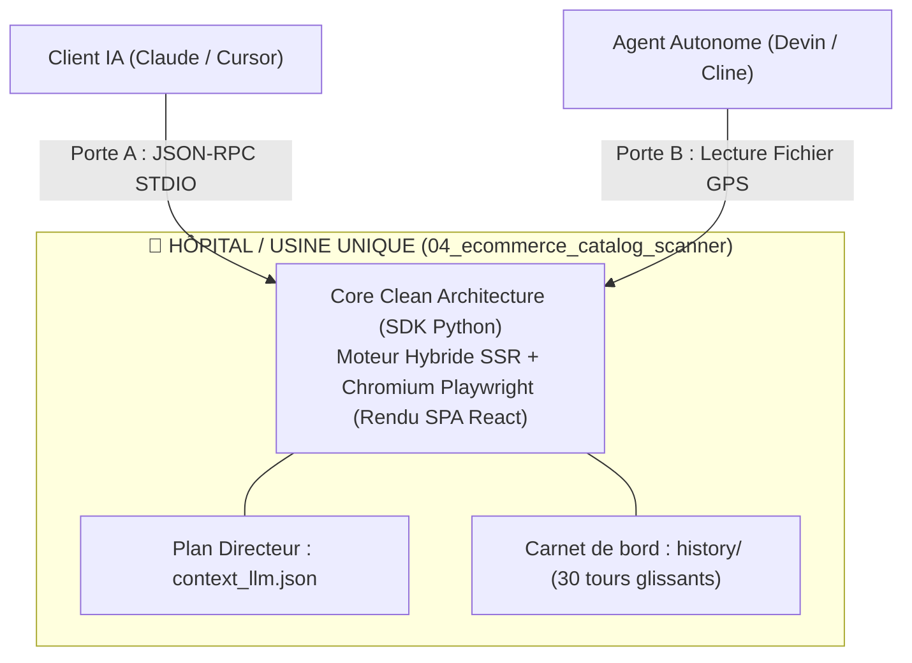

# 🚗 Outil Interne #04 : Scanneur DOM E-Commerce Sans API & Moissonneur Tarifaire (`04_ecommerce_catalog_scanner`)

> **Nom Industriel Évocateur Officiel :** Scanneur DOM E-Commerce Sans API & Moissonneur Tarifaire  
> **Répertoire Autonome :** `04_ecommerce_catalog_scanner`  
> **Type d'architecture :** "Voiture Autonome" (100 % autonome, zéro dépendance externe)  
> **Conception :** Clean Architecture (`core/domain/` $\leftarrow$ `core/application/` $\leftarrow$ `core/infrastructure/`)  
> **Qualité & Tests :** 4 couches de tests (Unitaires, Intégration, Validation/Perf, Smoke) $\rightarrow$ **10/10 PASS**

---

## 📌 1. À quoi sert cet outil ? (Rôle & Vision Universelle)

Le **Scanneur DOM E-Commerce Universel** permet d'extraire automatiquement et sans API les fiches produits complètes, prix, références SKU et images haute définition depuis **n'importe quel site e-commerce du marché** (PrestaShop, Shopify, WooCommerce, Magento ou développement sur mesure) :
- **Avant cet outil** : Le scanner était limité à un seul site codé en dur (ex: `inoxdesign.fr`). Impossible de traiter un autre acteur comme `railingsdesign.com`, `inoxkit.fr` ou un fournisseur tiers sans réécrire le code.
- **Grâce au Moteur Universel** :
  1. **N'importe quelle URL acceptée** : Donnez une URL directe (ex: `https://www.railingsdesign.com/12-garde-corps-verre`) sur l'interface Web (port 5183), en CLI ou via MCP.
  2. **Extraction multi-CMS automatique** : Détection des conteneurs PrestaShop (`.product-container`, `.ajax_block_product`), WooCommerce (`.woocommerce-loop-product`), Shopify (`.product-card`) et microdonnées Schema.org JSON-LD (`@type: Product`).
  3. **Résolution relative universelle** : Toutes les URLs de fiches et d'images relatives (`/garde-corps/...`) sont automatiquement converties en URLs absolues valides.
  4. **Amélioration HD automatique** : Détection des vignettes (ex: `-home_default`) et conversion automatique vers les visuels haute définition (`-thickbox_default`).
  5. **Déterminisme tarifaire** : Extraction du prix brut, conversion numérique stricte du TTC, calcul arithmétique garanti du HT ($TTC / 1.20$) et détection des unités (`mètre linéaire (ml)`, `m²`, `unité`).
  6. **Rapports doubles** : Génération immédiate du catalogue JSON structuré ET d'un rapport visuel HTML autonome interactif avec panneau d'aperçu photo.

---

## ⚙️ 2. Comment fonctionne-t-il ? (Sous le capot)

L'outil applique une **Clean Architecture** stricte :
- **Couche Domain (`core/domain/entities_and_ports.py`)** :
  - Entités métier : `ScannedProductEntity`, `CategoryTargetEntity`, `CategoryVignetteEntity`.
  - Ports abstraits : `IHttpPageFetcherPort`, `IDomCatalogParserPort`, `ICatalogPersistencePort`.
- **Couche Application / Use Cases (`core/application/use_cases.py`)** :
  - `DiscoverCategoryTreeUseCase` : Découverte récursive de l'arborescence e-commerce et des vignettes.
  - `ScanEcommerceCatalogUseCase` : Scan multi-catégories complet et persistance JSON.
  - `AuditScannedCatalogUseCase` : Analyse statistique, filtrage par famille (`01_kits`, `02_profils`, `04_pinces`, `05_points_spider`, `06_verres`) et recherche textuelle.
- **Couche Infrastructure (`core/infrastructure/`)** :
  - `UrllibPageFetcherAdapter` : Transport HTTP résilient avec gestion des timeouts et User-Agent navigateur.
  - `Bs4DomCatalogParserAdapter` : Parsing syntaxique BeautifulSoup4 et expressions régulières pour l'extraction de prix en euros français.
  - `JsonCatalogRepositoryAdapter` : Sauvegarde et lecture atomique JSON UTF-8.

---

## 🚀 3. Comment l'utiliser ? (Guide Pratique Multi-Canal & Deux Portes)

> **Règle d'or architecturale :** Il y a **un seul outil logiciel** (le cœur Clean Architecture), mais **deux portes d'entrée** qui mènent au **même plan (`context_llm.json`)** et au **même carnet de bord (`history/sessions/`)** :
> - **Porte A (MCP Standard)** : Pour Cursor, Claude Desktop, Antigravity (`mcp_server.py`).
> - **Porte B (Agent Coding Fichier)** : Pour les agents autonomes qui naviguent sur le disque (`context_llm.json`).



### A. Porte A — Installation 1-Clic pour Claude Desktop, Cursor et Antigravity
Collez simplement ce bloc dans votre fichier de configuration (`claude_desktop_config.json` ou `.cursor/mcp.json`) :

```json
{
  "mcpServers": {
    "04-scanneur-ecommerce": {
      "command": "python",
      "args": [
        "c:/Users/ntpar/Dev_IT/Projet_depo/Projet_IA/ia-pilote-e_commerce_saas/01_e-commerce matériel construction mvp/batihome-ecommerce-garde-corps/outils_internes/04_ecommerce_catalog_scanner/canal_mcp/mcp_classic_stdio/mcp_server.py"
      ]
    }
  }
}
```

**Installation des dépendances requises (local) :**
```bash
pip install -r requirements.txt
playwright install chromium
```

**Ce que reçoit l'IA en entrant par la Porte A :**
1. **Un Tool Public Unique (`run_agent_lifecycle`)** : Point d'entrée protégé qui empêche tout contournement, charge le contexte, lance le use case localement, compresse les résultats en digest et consigne le tour en mémoire.
2. **Le Plan Directeur & Mémoire** : Exposé via la ressource MCP officielle `context://plan/context_llm.json`.
3. **Le Carnet de bord automatique (`history/sessions/`)** : Chaque exécution enregistre un `turn_report.json` structuré et maintient la mémoire glissante de 30 tours dans `dynamic_history`.

### B. Porte B — Pour les Agents IA Autonomes (Prompt d'Auto-Installation)
Donnez simplement cette instruction à n'importe quel agent de code (Cursor, Cline, Windsurf, Devin) :
> *"Agent, prends en main l'outil 04. Ton plan directeur est dans `canal_mcp/mcp_agent_coding/context_llm.json`. Lis ce fichier, exécute tes actions via le CLI local ou le SDK Python, applique la règle Digest-First (ne jamais déverser de HTML/JSON brut dans la conversation), et archive ton compte-rendu dans `history/` via `ContextHistoryManager`."*

### C. Démonstrations Réelles Validées (100 % des types de sites du Web)
1. **E-Commerce Classique SSR (RailingsDesign - PrestaShop)** :
   ```bash
   python canal_sdk_cli/cli.py --url https://www.railingsdesign.com/12-garde-corps-verre
   ```
   *Résultat : 47 fiches produits extraites en 1,2 seconde avec prix TTC/HT et photos HD.*

2. **Applications Modernes SPA (BatiHome - Vite + React avec hash routing)** :
   ```bash
   python canal_sdk_cli/cli.py --url https://batihome.snorbik.fr/#P02_solutions
   ```
   *Résultat : Bascule automatique Playwright Chromium, 4 solutions complètes extraites.*

3. **Audit de Catalogue Contrôlé & Données Synthétiques (Reproductibilité & Zéro Dépendance)** :
   ```bash
   python canal_sdk_cli/cli.py --audit
   ```
   *Résultat : Audit statistique instantané sur 133 références étalons (prix extrêmes, calculs TVA vérifiés à 100 %, détection d'écarts).*

### C. Canal 2 — Pour les Utilisateurs Humains (Interface Graphique Web UI Universelle)
```bash
python canal_ui/server.py --port 5183
```
Ouvrez `http://localhost:5183` dans votre navigateur :
- **Barre de Scan Universel** : Collez n'importe quelle URL (ex: `https://www.railingsdesign.com/12-garde-corps-verre`) et cliquez sur `⚡ Scanner ce Site Universel`.
- **Presets multi-CMS prêts à l'emploi** : RailingsDesign (PrestaShop), InoxDesign (Magento), etc.
- **Affichage instantané** : Cartes produits avec photos HD thickbox, prix TTC/HT calculés et lien direct vers chaque fiche.
- **Rapport HTML autonome** : Bouton direct pour ouvrir la vue tableau récapitulative.

### D. Canal 3 — Pour les Développeurs & Scripts CLI
```bash
# 1. Scan universel à chaud de N'IMPORTE QUEL site ou URL e-commerce :
python canal_sdk_cli/cli.py --url https://www.railingsdesign.com/12-garde-corps-verre

# 2. Audit statistique du catalogue de référence :
python canal_sdk_cli/cli.py --audit

# 3. Recherche textuelle ou par référence :
python canal_sdk_cli/cli.py --search "CX500"
```
Ou importez le SDK Python dans votre code :
```python
from canal_sdk_cli.sdk import EcommerceCatalogScannerSDK
scanner = EcommerceCatalogScannerSDK()

# Scan universel direct :
res = scanner.scan_url("https://www.railingsdesign.com/12-garde-corps-verre")
print(f"Produits trouvés : {res['total_products']} sur {res['base_domain']}")
```

---

## 🤖 4. Installation Automatique en 1 Clic par une IA (One-Click Agent Prompt)

Si vous utilisez un agent de codage (Cursor, Claude Code, Windsurf, Antigravity), copiez simplement ce prompt et collez-le dans la console de votre IA :

```text
"Agis comme un ingénieur DevOps. Télécharge et configure pour moi l'outil MCP autonome :
Dépôt Git : https://github.com/<votre-compte-github>/scanneur_produits_boutique.git

Consignes d'installation automatique :
1. Clone le dépôt dans un dossier local 'scanneur_produits_boutique'.
2. Installe les dépendances via 'pip install -r requirements.txt'.
3. Exécute la suite de tests avec 'python tests/run_all_suites.py' pour vérifier que tout est à 100% PASS.
4. Ajoute automatiquement la configuration suivante dans mon fichier de configuration MCP :
   {
     "mcpServers": {
       "scanneur-produits-boutique": {
         "command": "python",
         "args": ["chemin/vers/scanneur_produits_boutique/canal_mcp/mcp_classic_stdio/mcp_server.py"]
       }
     }
   }
5. Confirme-moi quand le serveur est prêt et liste-moi ses outils disponibles."
```

---

## 💬 5. Comment parler à votre IA pour utiliser cet outil ? (Phrases types)

Une fois le serveur MCP connecté dans votre IDE, vous n'avez plus besoin de connaître le nom technique des scripts. Vous donnez simplement des instructions métier en français dans le chat de votre IA :

* **Pour lancer un scan complet de catalogue :**  
  > *"Scanne les catégories de garde-corps de cette boutique en ligne, récupère les prix TTC et calcule les prix HT pour constituer notre catalogue sans polluer notre conversation."*
* **Pour rechercher un accessoire précis :**  
  > *"Vérifie dans notre catalogue extrait si nous avons des pinces à verre pour tube rond et donne-moi leur tranche de prix."*
* **Pour tester la connectivité sans tout télécharger :**  
  > *"Fais un test de scan rapide limité à 2 catégories pour vérifier que le site répond bien."*
* **Pour lancer l'auto-contrôle qualité :**  
  > *"Vérifie que l'outil de scan fonctionne correctement en lançant sa suite de tests interne."*

