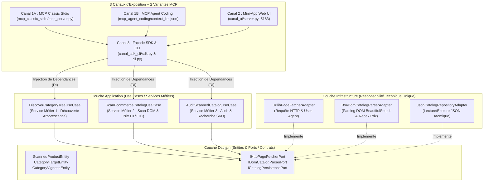

# 📖 Cahier des Charges, Vision Produit & Architecture Clean — `ecommerce_catalog_scanner_pipeline`
## Outil Interne #04 : Scanner E-Commerce DOM & Extracteur de Prix / SKU / Accessoires (Sans API)

> **Produit Logiciel :** `batihome-ecommerce-catalog-scanner`  
> **Version :** 1.0.0 — Octobre 2026  
> **Architecture Interne :** Clean Architecture Stricte (Domain $\leftarrow$ Application Use Cases avec Injection de Dépendances $\leftarrow$ Infrastructure à Responsabilité Technique Unique)  
> **Exposition :** 3 Canaux Canoniques + 2 Variantes MCP (`mcp_classic_stdio` & `mcp_agent_coding`)

---

## 🧭 1. Vision du Produit & Problème Métier Résolu

### 1.1. Pourquoi ce produit existe-t-il ?
Lors de la conception d'un site e-commerce industriel spécialisé (comme le démonstrateur **BatiHome**, dédié aux garde-corps vitrés et à leurs accessoires), l'équipe produit et les développeurs doivent constituer une **matière première exhaustive** à partir de sites de référence du secteur (ex: `inoxdesign.fr`, `inoxkit.fr`) qui **ne proposent aucune API publique**.

Coder des scripts jetables à chaque besoin entraîne une perte de savoir-faire. Cet outil interne transforme cette capacité d'extraction sans API en un **produit logiciel réutilisable et prêt pour l'Open Source**.

### 1.2. Quels problèmes concrets résout-il ?
1. **Découverte d'arborescence sans API** : Cartographie automatique des sous-catégories et vignettes du mégamenu à partir d'une page racine.
2. **Parsing résilient des cartes produits DOM** : Extraction des références **SKU** (depuis la nomenclature des fichiers médias et liens), des **titres techniques**, des **prix TTC**, du **calcul automatique HT (TVA 20 %)** et de l'**unité de vente** (`mètre linéaire (ml)`, `m²`, `unité`).
3. **Fusion multi-catégories sans doublon** : Un même accessoire (ex: cale ID VARIO, aligneur verre 90°, tige filetée M10) présent dans 3 rubriques est fusionné en une seule entité enrichie de toutes ses catégories d'appartenance.

---

## 👥 2. Personas (Qui utilise ?) & Actions Utilisateur

| Persona / Acteur | Canal Utilisé | Actions Utilisateur & Cas d'Usage |
| :--- | :--- | :--- |
| **1. Agent IA Autonome (Coding Agent)** | **Canal 1 — Variante B (`mcp_agent_coding`)** | 1. Lit `README.md` puis le manifeste GPS `context_llm.json`.<br/>2. Consulte l'historique statique et les 30 derniers tours.<br/>3. Exécute `scan_glass_railing_catalog` ou `audit_and_search_scanned_catalog`.<br/>4. Archive un compte rendu compressé sémantiquement via `ContextHistoryManager`. |
| **2. Assistant IA IDE (Claude / Cursor / AGY)** | **Canal 1 — Variante A (`mcp_classic_stdio`)** | Appelle directement les tools MCP en JSON-RPC stdio (`discover_ecommerce_categories`, `audit_and_search_scanned_catalog`) pour répondre à une question tarifaire ou technique. |
| **3. Chef de Produit / Acheteur / Designer** | **Canal 2 — Mini-App Web (`http://localhost:5183`)** | Ouvre le Dashboard graphique BatiHome dans son navigateur, filtre les 133 références par famille (`Profilés`, `Pinces`, `Spider`, `Verres`), vérifie les photos et les prix TTC/HT. |
| **4. Développeur Full-Stack / Ingénieur Data** | **Canal 3 — SDK & CLI (`canal_sdk_cli/`)** | Exécute `cli.py --scan` ou importe `EcommerceCatalogScannerSDK` dans un pipeline CI/CD. |

---

## 🏛️ 3. Architecture Interne Clean Architecture & Injection de Dépendances

Conformément à notre norme d'ingénierie, le cœur de l'outil (`core/`) sépare strictement les **Services Métiers (Use Cases)** des **Responsabilités Techniques Uniques (Infrastructure)** grâce à l'**Inversion de Dépendance (DIP)** :



### Détail des 3 Couches (`core/`)

1. **`core/domain/entities_and_ports.py`** :
   - **Entités** : `CategoryTargetEntity`, `CategoryVignetteEntity`, `ScannedProductEntity`.
   - **Ports (Interfaces)** : `IHttpPageFetcherPort`, `IDomCatalogParserPort`, `ICatalogPersistencePort`.
2. **`core/infrastructure/` (Responsabilité Technique Unique)** :
   - `urllib_page_fetcher.py` (`UrllibPageFetcherAdapter`) : Unique responsabilité de télécharger le flux HTML brut d'une page distante avec en-têtes navigateur.
   - `bs4_dom_catalog_parser.py` (`Bs4DomCatalogParserAdapter`) : Unique responsabilité de parser l'arbre DOM HTML avec BeautifulSoup4 et d'extraire SKU, titres, prix TTC/HT et unités.
   - `json_catalog_repository.py` (`JsonCatalogRepositoryAdapter`) : Unique responsabilité de lire/écrire le fichier JSON sur disque.
3. **`core/application/use_cases.py` (Services Métiers par Injection de Dépendances)** :
   - `DiscoverCategoryTreeUseCase` : Reçoit `IHttpPageFetcherPort` et `IDomCatalogParserPort`.
   - `ScanEcommerceCatalogUseCase` : Reçoit `IHttpPageFetcherPort`, `IDomCatalogParserPort` et `ICatalogPersistencePort`.
   - `AuditScannedCatalogUseCase` : Reçoit `ICatalogPersistencePort`.

---

## 🚀 4. Commandes d'Exécution des 3 Canaux

```bash
# Canal 3 : CLI (Audit des 133 références, recherche SKU, découverte d'URL)
python outils_internes/ecommerce_catalog_scanner_pipeline/canal_sdk_cli/cli.py --audit
python outils_internes/ecommerce_catalog_scanner_pipeline/canal_sdk_cli/cli.py --search "IN607"

# Canal 2 : Mini-Application Graphique Web (Design System BatiHome sur port 5183)
python outils_internes/ecommerce_catalog_scanner_pipeline/canal_ui/server.py --port 5183

# Canal 1 (Variante A) : Serveur MCP Classique stdio
python outils_internes/ecommerce_catalog_scanner_pipeline/canal_mcp/mcp_classic_stdio/mcp_server.py

# Canal 1 (Variante B) : Cycle de vie MCP Agent Coding (Mise à jour mémoire 30 tours)
python outils_internes/mcp_shared/context_history_manager.py --context-file outils_internes/ecommerce_catalog_scanner_pipeline/canal_mcp/mcp_agent_coding/context_llm.json --record-demo
```
