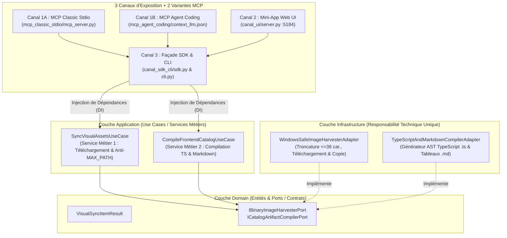

# 📖 Cahier des Charges, Vision Produit & Architecture Clean — `visual_catalog_sync_pipeline`
## Outil Interne #05 : Synchroniseur d'Assets Visuels Anti-MAX_PATH Windows & Compilateur TypeScript / Markdown

> **Produit Logiciel :** `batihome-visual-catalog-sync`  
> **Version :** 1.0.0 — Octobre 2026  
> **Architecture Interne :** Clean Architecture Stricte (Domain $\leftarrow$ Application Use Cases avec Injection de Dépendances $\leftarrow$ Infrastructure à Responsabilité Technique Unique)  
> **Exposition :** 3 Canaux Canoniques + 2 Variantes MCP (`mcp_classic_stdio` & `mcp_agent_coding`)

---

## 🧭 1. Vision du Produit & Problème Métier Résolu

### 1.1. Pourquoi ce produit existe-t-il ?
Lorsqu'on récupère des centaines d'images de produits et d'accessoires depuis un site de référence (ex: 140 images de profilés, cales, pinces à verre, boutons Spider et panneaux vitrés), trois problèmes techniques surviennent systématiquement :
1. **L'erreur critique Windows `MAX_PATH` (260 caractères)** : Les noms de fichiers d'images e-commerce SEO sont souvent très longs (`verre-feuillete-trempe-extra-clair-hst-sur-mesure.jpg`). Combinés à l'arborescence profonde d'un dépôt Windows, l'écriture échoue avec `[Errno 2] No such file or directory`.
2. **La désynchronisation entre le dossier de matière première (`base_src/...`) et le dossier public React (`frontend/public/assets/...`)**.
3. **Le maintien manuel des fichiers TypeScript du Frontend** : Convertir 133 références JSON en un module TypeScript fortement typé (`RawGlassRailingCatalog.ts`) et un inventaire Markdown (`CATALOGUE_MATIERE_PREMIERE_GARDE_CORPS_VERRE.md`) doit être 100 % automatisé.

---

## 👥 2. Personas (Qui utilise ?) & Actions Utilisateur

| Persona / Acteur | Canal Utilisé | Actions Utilisateur & Cas d'Usage |
| :--- | :--- | :--- |
| **1. Agent IA Autonome (Coding Agent)** | **Canal 1 — Variante B (`mcp_agent_coding`)** | Lit `README.md` $\rightarrow$ `context_llm.json`, exécute `sync_visual_catalog_assets` et `compile_typescript_and_markdown_catalog`, puis enregistre son compte rendu compressé sémantiquement via `ContextHistoryManager` (fenêtre glissante de 30 tours). |
| **2. Assistant IA IDE (Claude / Cursor / AGY)** | **Canal 1 — Variante A (`mcp_classic_stdio`)** | Appelle les tools MCP en stdio pour synchroniser les images et recompiler le catalogue TypeScript. |
| **3. Intégrateur Front / Designer** | **Canal 2 — Mini-App Web (`http://localhost:5184`)** | Vérifie en 1 coup d'œil que `0 image` ne manque, que la longueur maximale de chemin Windows est `< 260 caractères` et clique sur **Compiler TypeScript & Markdown**. |
| **4. Développeur Full-Stack** | **Canal 3 — SDK & CLI (`canal_sdk_cli/`)** | Exécute `cli.py --all` dans un script de build ou un hook Git. |

---

## 🏛️ 3. Architecture Interne Clean Architecture & Injection de Dépendances



---

## 🚀 4. Commandes d'Exécution des 3 Canaux

```bash
# Canal 3 : CLI (Synchronisation visuelle + Compilation TypeScript & Markdown)
python outils_internes/visual_catalog_sync_pipeline/canal_sdk_cli/cli.py --all

# Canal 2 : Mini-Application Graphique Web (Design System BatiHome sur port 5184)
python outils_internes/visual_catalog_sync_pipeline/canal_ui/server.py --port 5184

# Canal 1 (Variante A) : Serveur MCP Classique stdio
python outils_internes/visual_catalog_sync_pipeline/canal_mcp/mcp_classic_stdio/mcp_server.py

# Canal 1 (Variante B) : Cycle de vie MCP Agent Coding (Mise à jour mémoire 30 tours)
python outils_internes/mcp_shared/context_history_manager.py --context-file outils_internes/visual_catalog_sync_pipeline/canal_mcp/mcp_agent_coding/context_llm.json --record-demo
```
