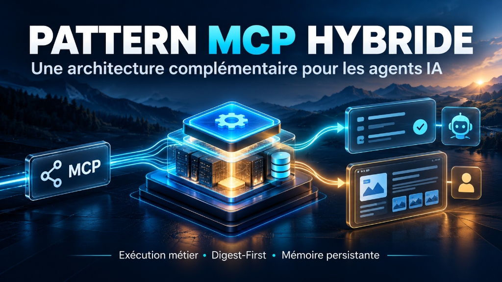
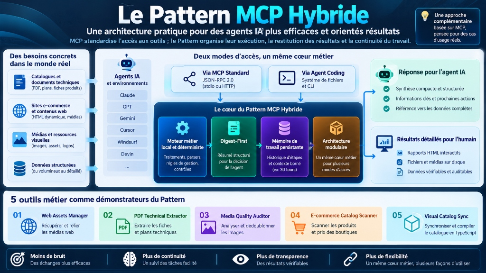
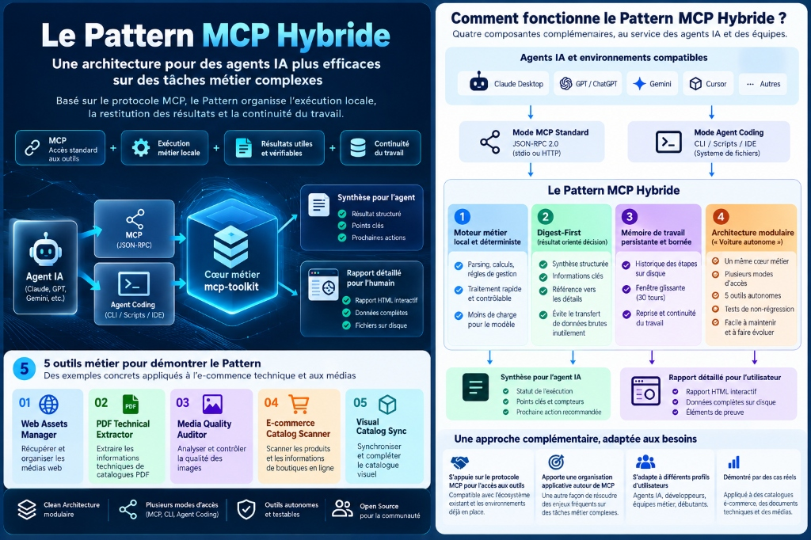

<p align="right">
  <b>Language:</b> 🇬🇧 English | <a href="./README.fr.md">🇫🇷 Français</a>
</p>

# 🛠️ Hybrid MCP Architecture for AI Agents

> **Five modular MCP servers demonstrating deterministic tool execution, compact Digest-First responses, persistent working memory, and shared business logic across supported access modes.**

<p align="center">
  
  
  
  
  
  
</p>

---

<p align="center">
  
</p>

> **The Hybrid MCP Core Axiom:**  
> *« Standard MCP standardizes tool connectivity; the Hybrid Pattern organizes tool execution, context budgeting, and workflow continuity. »*

---

## 🎯 1. Overview & Architectural Contribution

**`mcp-hybrid-architecture`** is an open-source suite of **5 autonomous, production-ready Model Context Protocol (MCP) servers** built in Python and Node.js. It demonstrates the **Hybrid MCP Pattern**—a software engineering blueprint designed for AI coding agents (*Cursor, Claude Desktop, Antigravity IDE, Windsurf, Claude Code, Devin*).

While standard MCP defines how an AI agent connects to a local or remote tool via JSON-RPC, real-world data pipelines (DOM parsing, large PDF technical extractions, high-resolution media audits) frequently degrade LLM workflows due to **context bloat**, **execution instability**, and **session amnesia**.

This project provides a battle-tested reference implementation answering a crucial challenge: **How can AI agents reliably operate multi-step data pipelines on tens of thousands of items without exhausting context limits or hallucinating?**

### Key Capabilities
- 🚀 **5 Autonomous MCP Servers**: Covering web asset downloading, PDF blueprint extraction, image quality audits, e-commerce catalog scraping, and TypeScript visual catalog synchronization.
- 📉 **-99.8% Token Consumption ("Digest-First")**: Returns a compact executive summary (e.g., 470 bytes) to the LLM while saving full raw data and interactive HTML reports locally on disk.
- 🧠 **Persistent 30-Turn Session Memory**: Avoids context drift and amnesia across long-running multi-step jobs.
- 🌐 **Dual Access Modes**: Seamless operation via standard `stdio` JSON-RPC or via a universal HTTP/REST reverse gateway (port 5185).
- 🛡️ **Zero Data Loss & Determinism**: Strict separation between the deterministic business engine and high-level LLM reasoning.

---

## ⚠️ 2. The Problem We Solve

Integrating LLMs with external tools via raw MCP endpoints often uncovers three operational bottlenecks in production:

| Challenge | Raw MCP Behavior | Hybrid MCP Pattern Solution |
| :--- | :--- | :--- |
| **Context Window Saturation** | An extraction tool dumps 200 KB of raw DOM or JSON directly into the LLM context. | **Digest-First Strategy**: The engine writes artifacts to disk and passes only a concise 470-byte summary to the agent context. |
| **Non-Deterministic Execution** | Complex arithmetic, parsing, and image transformations are entrusted to LLM reasoning. | **Local Deterministic Engines**: Math, regex, image hashes, and PDF rendering execute in compiled local code (PyMuPDF, Pillow). |
| **Multi-Turn Session Amnesia** | After 10+ turns, earlier instructions or intermediate outputs are truncated or forgotten. | **Persistent Session Memory**: A 30-turn rolling engineering logbook (`turn_report.json`) tracks task status and artifacts. |

---

## 💡 3. Architecture & The 4 Core Pillars

The **Hybrid MCP Pattern** decouples heavy deterministic execution from high-level LLM reasoning. Two comprehensive infographics detail the macro system architecture and its micro-level mechanics:

### 📐 3.1 Macro View: End-to-End System Architecture
This diagram displays the full lifecycle: from real-world business constraints to dual delivery (compact summary for AI agent, rich interactive HTML for the human developer), across dual access modes (`stdio` and HTTP gateway).

<p align="center">
  
</p>

---

### ⚙️ 3.2 Micro View: How It Works Under the Hood
This operational blueprint explains the step-by-step mechanics ensuring maximum agent efficiency without context exhaustion:

<p align="center">
  
</p>

#### Summary of the 4 Pillars:
1. **Domain-Driven Local Engine (Autonomous Vehicles):** Each tool (`01_` to `05_`) follows Clean Architecture (*Domain, Application, Infrastructure*). Tools run independently with their own standalone CLI, embedded test suite, and standalone local web preview.
2. **Digest-First & Local Artifacts:** Tools execute deterministically on local hardware, write output files (HTML/JSON/PNG) to an `output/` folder, and return a lightweight executive summary with disk references to the AI context.
3. **Rolling 30-Turn Working Memory:** A persistent session log (`turn_report.json` via `context_history_manager.py`) maintains situational awareness across multi-step tasks without expanding context token count.
4. **Modular Architecture & Universal Gateway:** Full compatibility with standard `stdio` MCP clients, plus an optional unified HTTP/REST reverse gateway (`mcp_shared/mcp_http_gateway.py` on port 5185) exposing all 17 tools through a single network endpoint.

---

## 🧭 4. The Five Modular MCP Servers

The suite features 5 production demonstrators validated against a real-world e-commerce reference case (BatiHome architectural hardware catalog):

| Directory | Industrial Role | Tech Stack | Generated Artifacts |
| :--- | :--- | :--- | :--- |
| [`01_web_assets_manager/`](./01_web_assets_manager/) | **Web Assets Manager & React Binder**: Scans HTML mockups, downloads remote assets, and updates relative asset paths in React components. | Node.js 18+ | `assets-manifest.json`, updated React components |
| [`02_pdf_technical_extractor/`](./02_pdf_technical_extractor/) | **Technical PDF Extractor**: Segments manufacturer PDF catalogs, extracts vector CAD schemas, and renders high-definition 150 DPI page proofs. | Python 3.10+, PyMuPDF | Extracted CAD diagrams, cropped PDF spec sheets |
| [`03_media_quality_auditor/`](./03_media_quality_auditor/) | **Media Quality Auditor & Deduplicator**: Verifies image sharpness, checks strict dimension rules ($\ge 1200	imes 700$), and purges duplicates using MD5 hashes. | Python 3.10+, Pillow | Compliance audit reports, duplicate asset lists |
| [`04_ecommerce_catalog_scanner/`](./04_ecommerce_catalog_scanner/) | **E-commerce Catalog Scanner**: Analyzes online store DOMs (SSR PrestaShop & SPA React), extracts SKUs and tax-inclusive prices, and produces interactive visual reports. | Python 3.10+, BeautifulSoup4 *(Playwright optional)* | `catalogue.json`, interactive HTML dashboard |
| [`05_visual_catalog_sync/`](./05_visual_catalog_sync/) | **Visual Catalog Synchronizer & TS Compiler**: Enforces Windows safe-path length constraints (`MAX_PATH < 260`) and compiles catalog schemas to typed TypeScript modules. | Python 3.10+ *(0 pip dependencies)* | `RawGlassRailingCatalog.ts`, sanitized local media |

---

## 🚀 5. Quick Start & Installation

### Prerequisites
- **Python**: Version `3.10` to `3.12+` (64-bit).
- **Node.js**: Version `18.0+` (LTS recommended) — *Required for Tool #01 only*.
- **Operating System**: Windows 10/11, Linux, macOS.

---

### Pathway 1 — Automated Installation on Windows (Recommended)
Double-click `install.bat` or run in terminal:
```cmd
install.bat
```
*This script verifies Python, creates the isolated virtual environment `.venv`, upgrades pip, installs all requirements, and runs a baseline diagnostic.*

Run the health check at any time:
```cmd
doctor.bat
```

---

### Pathway 2 — Manual Installation (Linux / macOS / Developers)
```bash
# 1. Create and activate virtual environment
python3 -m venv .venv
source .venv/bin/activate

# 2. Install Python dependencies
pip install --upgrade pip
pip install -r requirements-all.txt

# 3. Install Node.js dependencies (for Tool #01)
npm install

# 4. Verify system health
python -m pytest tests/ -q
```

---

### Pathway 3 — AI Agent Installation Prompt
Working inside **Cursor**, **Claude Desktop**, **Windsurf**, or **Antigravity IDE**?  
Copy and paste the self-contained prompt from [**`PROMPT_INSTALLATION_AGENT.md`**](./PROMPT_INSTALLATION_AGENT.md) directly into your agent's chat window. The agent will autonomously clone, verify, configure `mcp_config.json`, and run diagnostic tests.

---

## 🧪 6. Usage Examples & Access Modes

### Mode A: Standard MCP Configuration (`stdio`)
Import the pre-configured [**`mcp_config.json`**](./mcp_config.json) into your IDE (Cursor, Claude Desktop, Antigravity):

```json
{
  "mcpServers": {
    "ecommerce-scanner": {
      "command": ".venv/Scripts/python.exe",
      "args": ["04_ecommerce_catalog_scanner/mcp_server.py"]
    },
    "pdf-extractor": {
      "command": ".venv/Scripts/python.exe",
      "args": ["02_pdf_technical_extractor/mcp_server.py"]
    }
  }
}
```

### Mode B: Universal HTTP / REST Gateway (Port 5185)
For networked, containerized, or web-based AI agents:
```bash
python mcp_shared/mcp_http_gateway.py --port 5185
```
- **Health Check:** `GET http://localhost:5185/health` (returns `{"status": "ok", "total_tools": 17}`)
- **Tool Discovery:** `GET http://localhost:5185/tools` (enumerates all 17 available tools)
- **Tool Execution:** `POST http://localhost:5185/tools/call` with payload `{"name": "extract_catalog", "arguments": {...}}`

### Mode C: Standalone CLI
Every tool functions independently without MCP:
```bash
# Example: Audit local media directory
python 03_media_quality_auditor/main.py --input ./assets/images --min-width 1200 --min-height 700

# Example: Scan catalog mockup
python 04_ecommerce_catalog_scanner/main.py --source ./data/sample_store.html --output ./output
```

---

## 📊 7. Tests & Verifiable Benchmarks

This repository adheres to strict test-driven reliability standards.

### Running Non-Regression Test Suite (52/52 Tests)
On Windows:
```cmd
run_all_tests.bat
```
On Linux / macOS:
```bash
pytest 01_web_assets_manager 02_pdf_technical_extractor 03_media_quality_auditor 04_ecommerce_catalog_scanner 05_visual_catalog_sync -v
```

### Reference Benchmark (BatiHome E-Commerce Case Study)
- **Raw Web Data Volume:** 228 KB (HTML DOM + unparsed inline assets).
- **Standard In-Context Payload:** ~57,000 tokens per tool call.
- **Hybrid MCP Digest-First Payload:** **470 bytes (~115 tokens)** passed to agent context.
- **Context Economy:** **-99.8% reduction in token consumption**.
- **Human Verification:** Complete 24-page interactive HTML report generated with zero loss of fidelity.

---

## 🛡️ 8. Known Limitations & Production Best Practices

1. **Dynamic Single Page Applications (SPAs):** Tool #04 includes optional Playwright support for JavaScript-rendered SPAs. For protected third-party websites with CAPTCHAs, scan local HTML exports or staging environments.
2. **Windows Path Length Limit:** Tool #05 defensively enforces hash-based truncation (`MAX_PATH < 260`) to avoid Windows path overflow exceptions.
3. **Environment Isolation:** Always execute scripts within the isolated `.venv` virtual environment to prevent dependency conflicts.

---

## 🔗 9. Repository Navigation & Resources

* 📦 [**Detailed Installation Guide (`INSTALL.md`)**](./INSTALL.md)
* 🇫🇷 [**Documentation Complète en Français (`README.fr.md`)**](./README.fr.md)
* 🤖 [**AI Agent Prompt (`PROMPT_INSTALLATION_AGENT.md`)**](./PROMPT_INSTALLATION_AGENT.md)
* 📋 [**MCP Configuration Template (`mcp_config.json`)**](./mcp_config.json)
* 📖 [**Agent & MCP Integration Guide (`docs/GUIDE_INTEGRATION_MCP_ET_AGENTS.md`)**](./docs/GUIDE_INTEGRATION_MCP_ET_AGENTS.md)
* 🏛️ [**Architectural Demonstrations (`docs/DEMONSTRATIONS_ARCHITECTURE_MCP_HYBRIDE.md`)**](./docs/DEMONSTRATIONS_ARCHITECTURE_MCP_HYBRIDE.md)
* ⚖️ [**MIT License (`LICENSE`)**](./LICENSE)

---

<p align="center">
  <b>Built with precision by the SNORBIK AI Engineering Team.</b><br>
  <i>Empowering autonomous AI agents with deterministic, context-efficient tooling.</i>
</p>
