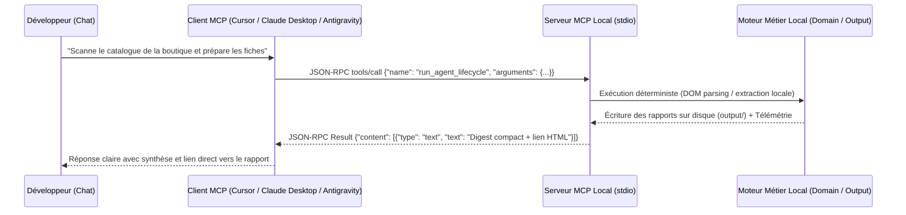

# 🔌 Guide d'Intégration MCP Standard (Variante A)

Ce guide s'adresse aux développeurs et utilisateurs souhaitant connecter de manière **permanente** les serveurs MCP de la suite **`mcp-hybrid-architecture`** à leurs clients d'IA compatibles avec la spécification officielle **Model Context Protocol (JSON-RPC 2.0)** : **Cursor**, **Claude Desktop**, **Antigravity IDE**, ou **Windsurf**.

---

## 📋 Vue d'Ensemble de l'Architecture de Communication

Les 5 outils exposent un serveur MCP standard communiquant sur l'entrée/sortie standard (`stdio`) via des trames JSON-RPC 2.0 conformes à la spécification :



---

## ⚙️ Fichier de Configuration Prêt à l'Emploi (`mcp_config.json`)

Le fichier [**`mcp_config.json`**](../mcp_config.json) situé à la racine du dépôt déclare l'intégralité des 5 serveurs :

```json
{
  "mcpServers": {
    "01-web-assets-manager": {
      "command": "node",
      "args": ["01_web_assets_manager/canal_mcp/mcp_classic_stdio/mcp_server.mjs"],
      "description": "Gestionnaire d'assets web et relieur React"
    },
    "02-pdf-technical-extractor": {
      "command": ".venv/Scripts/python.exe",
      "args": ["02_pdf_technical_extractor/canal_mcp/mcp_classic_stdio/mcp_server.py"],
      "description": "Extracteur technique de catalogues et plans PDF"
    },
    "03-media-quality-auditor": {
      "command": ".venv/Scripts/python.exe",
      "args": ["03_media_quality_auditor/canal_mcp/mcp_classic_stdio/mcp_server.py"],
      "description": "Auditeur de qualité photos et dédoublonneur MD5"
    },
    "04-ecommerce-catalog-scanner": {
      "command": ".venv/Scripts/python.exe",
      "args": ["04_ecommerce_catalog_scanner/canal_mcp/mcp_classic_stdio/mcp_server.py"],
      "description": "Scanneur de catalogue e-commerce et digest-first"
    },
    "05-visual-catalog-sync": {
      "command": ".venv/Scripts/python.exe",
      "args": ["05_visual_catalog_sync/canal_mcp/mcp_classic_stdio/mcp_server.py"],
      "description": "Synchroniseur de médias safe-path et compilateur TypeScript"
    }
  }
}
```

> 💡 **Astuce Chemins Multiplateformes :**  
> * Sous **Windows** : Utilisez `.venv/Scripts/python.exe` (ou `python`).
> * Sous **Linux / macOS** : Utilisez `.venv/bin/python` (ou `python3`).
> * Si votre client exige des chemins absolus, remplacez par le chemin complet de votre dossier racine (ex: `C:/Users/Nom/MCP/...`).

---

## 🛠️ Configuration Détaillée par Client MCP

### 1. Configuration dans **Cursor**
1. Ouvrez Cursor, allez dans les **Paramètres** (`Ctrl + ,` ou `Cmd + ,`).
2. Dans le menu de gauche, sélectionnez **Features** $
ightarrow$ **MCP Servers**.
3. Cliquez sur **+ Add New MCP Server**.
4. Remplissez les champs :
   - **Name :** `ecommerce-scanner` (ou le nom de l'outil souhaité)
   - **Type :** `command` (stdio)
   - **Command :** `.venv/Scripts/python.exe 04_ecommerce_catalog_scanner/canal_mcp/mcp_classic_stdio/mcp_server.py`
5. Vous pouvez également éditer directement le fichier `.cursor/mcp.json` à la racine de votre projet.

### 2. Configuration dans **Claude Desktop**
1. Ouvrez Claude Desktop, ouvrez les paramètres (`Ctrl + ,` ou `Cmd + ,`), onglet **Developer**.
2. Cliquez sur **Edit Config** pour ouvrir le fichier `claude_desktop_config.json`.
   - Chemin Windows : `%APPDATA%\Claude\claude_desktop_config.json`
   - Chemin macOS : `~/Library/Application Support/Claude/claude_desktop_config.json`
3. Collez le bloc `mcpServers` ci-dessus et enregistrez le fichier.
4. Redémarrez complètement Claude Desktop.

### 3. Configuration dans **Antigravity IDE** ou **Windsurf**
1. Ouvrez les réglages MCP de votre environnement (`Settings` $
ightarrow$ `MCP`).
2. Importez directement le fichier `mcp_config.json` ou collez la définition du serveur souhaité.
3. Actualisez la liste des serveurs pour voir le statut passer au vert (**Connected**).

---

## 🔍 Fiches d'Intégration des 5 Outils MCP

---

### 1️⃣ Outil #01 : Web Assets Manager

* **Prérequis :** Node.js 18+, npm install exécuté dans `01_web_assets_manager`.
* **Transport stdio :** `node 01_web_assets_manager/canal_mcp/mcp_classic_stdio/mcp_server.mjs`
* **Outils Découverts (`tools/list`) :**
  1. `scan_and_download_maquette_assets` : Télécharge localement les photos d'une maquette HTML et génère `assets-manifest.json`.
  2. `replace_remote_urls_in_react` : Remplace les URLs distantes dans les fichiers React (supporte `dry_run: true/false`).
  3. `get_web_assets_manifest` : Retourne la liste JSON des assets locaux.
  4. `run_quality_and_tests_suite` : Lance les tests de validation de l'outil.
* **Premier appel de test :**
  Demandez dans le chat : `"Peux-tu appeler l'outil get_web_assets_manifest pour voir la liste des images déjà présentes ?"`
* **3 Exemples de demandes en langage naturel :**
  - *"Analyse la maquette HTML dans docs/ et télécharge toutes les images distantes dans le dossier public."*
  - *"Fais une simulation (dry-run) de remplacement des URLs distantes dans mes composants React."*
  - *"Applique définitivement la reliaison des images locales dans le code React et confirme les modifications."*

---

### 2️⃣ Outil #02 : PDF Technical Extractor

* **Prérequis :** Python 3.10+, bibliothèque `PyMuPDF` (`fitz`).
* **Transport stdio :** `python 02_pdf_technical_extractor/canal_mcp/mcp_classic_stdio/mcp_server.py`
* **Outils Découverts (`tools/list`) :**
  1. `process_pdf_document` : Découpe les pages, génère le rendu HD 150 DPI et extrait les schémas vectoriels (`pdf_path`, `output_dir`, `dpi`).
  2. `get_pdf_manifest` : Lit l'inventaire `manifest.json` d'un document traité (`document_dir`).
  3. `get_pdf_document_text` : Retourne l'intégralité du texte extrait en Markdown (`document_dir`).
  4. `run_quality_and_tests_suite` : Exécute les tests de non-régression de l'extracteur.
* **Premier appel de test :**
  Demandez dans le chat : `"Exécute run_quality_and_tests_suite sur le serveur PDF pour vérifier que le moteur PyMuPDF est prêt."`
* **3 Exemples de demandes en langage naturel :**
  - *"Découpe le catalogue PDF 'data/catalogue_garde_corps.pdf' en pages HD à 150 DPI."*
  - *"Récupère le texte Markdown extrait du PDF traité pour que nous puissions analyser les spécifications de fixation."*
  - *"Donne-moi le manifeste technique des schémas CAO extraits du document."*

---

### 3️⃣ Outil #03 : Media Quality Auditor

* **Prérequis :** Python 3.10+, bibliothèque `Pillow`.
* **Transport stdio :** `python 03_media_quality_auditor/canal_mcp/mcp_classic_stdio/mcp_server.py`
* **Outils Découverts (`tools/list`) :**
  1. `audit_media_folder` : Analyse dimensions, ratios et netteté (`folder_path`, `min_width`, `min_height`).
  2. `get_certified_hero_candidates` : Liste les photos d'au moins 1200x700 certifiées pour les bannières (`folder_path`).
  3. `clean_duplicate_media` : Détecte et supprime les doublons MD5 (`folder_path`, `dry_run: true/false`).
  4. `run_quality_and_tests_suite` : Exécute la suite de tests de l'auditeur média.
* **Premier appel de test :**
  Demandez dans le chat : `"Audite le dossier d'images frontend/public/images/ avec une résolution minimale de 1200x700."`
* **3 Exemples de demandes en langage naturel :**
  - *"Quelles sont les images certifiées HD dans mon dossier média prêtes pour la page d'accueil ?"*
  - *"Fais une simulation de détection des images en double via leur empreinte MD5."*
  - *"Purge les doublons stricts identifiés dans le dossier de photos."*

---

### 4️⃣ Outil #04 : E-commerce Catalog Scanner (Digest-First)

* **Prérequis :** Python 3.10+, bibliothèque `BeautifulSoup4`.
* **Transport stdio :** `python 04_ecommerce_catalog_scanner/canal_mcp/mcp_classic_stdio/mcp_server.py`
* **Outils Découverts (`tools/list`) :**
  1. `run_agent_lifecycle` : Point d'entrée universel du pattern Digest-First.  
     Arguments : `use_case` (`scan_ecommerce_catalog`, `discover_category_tree`, `audit_scanned_catalog`, `run_quality_and_tests_suite`) et `arguments` associés (`url`, `family_filter`, `search_query`).
* **Premier appel de test :**
  Demandez dans le chat : `"Lance un audit du catalogue déjà scanné pour afficher les statistiques globales."`
* **3 Exemples de demandes en langage naturel :**
  - *"Scanne les fiches produits et prix sur le démonstrateur BatiHome à l'adresse https://batihome.snorbik.fr/#P02_solutions."*
  - *"Recherche toutes les références SKU contenant 'pince' dans le catalogue scanné."*
  - *"Donne-moi le résumé du catalogue et ouvre le rapport visuel interactif HTML généré."*

---

### 5️⃣ Outil #05 : Visual Catalog Sync

* **Prérequis :** Python 3.10+ (aucune dépendance tierce requise).
* **Transport stdio :** `python 05_visual_catalog_sync/canal_mcp/mcp_classic_stdio/mcp_server.py`
* **Outils Découverts (`tools/list`) :**
  1. `sync_visual_assets` : Rapatrie les photos du catalogue avec troncature sécurisée des noms (safe-path Windows < 260).
  2. `compile_frontend_catalog` : Compile les données en module TypeScript (`RawGlassRailingCatalog.ts`) et Markdown.
  3. `sync_and_compile_all` : Exécute le cycle complet (téléchargement + compilation).
  4. `run_quality_and_tests_suite` : Exécute les tests de non-régression de synchronisation.
* **Premier appel de test :**
  Demandez dans le chat : `"Vérifie l'état de synchronisation des visuels du catalogue via sync_visual_assets."`
* **3 Exemples de demandes en langage naturel :**
  - *"Télécharge les photos manquantes du catalogue en respectant la contrainte de chemin Windows."*
  - *"Compile le fichier catalogue.json en code TypeScript typé pour mon application React."*
  - *"Lance la synchronisation complète et compile l'inventaire Markdown du catalogue."*

---

## 🌐 Alternative Réseau : Passerelle Universelle HTTP / REST (Port 5185)

Si votre agent s'exécute dans un conteneur Docker, une machine distante ou un client n'ayant pas accès aux processus `stdio` locaux, vous pouvez démarrer la **passerelle HTTP unifiée** qui rassemble les 17 outils sous une interface réseau unique :

```bash
# Démarrer la passerelle HTTP
python mcp_shared/mcp_http_gateway.py --port 5185
```

* **Vérification de Santé :** `GET http://localhost:5185/health`  
  *Retourne le statut et la liste des outils agrégés.*
* **Découverte des Outils :** `GET http://localhost:5185/tools`
* **Invocation d'Outil :**  
  `POST http://localhost:5185/tools/call`  
  Payload JSON :
  ```json
  {
    "name": "04-run_agent_lifecycle",
    "arguments": {
      "use_case": "audit_scanned_catalog",
      "arguments": { "family_filter": "all" }
    }
  }
  ```

---

## 🛡️ Gestion des Autorisations et Résolution des Problèmes Fréquents

1. **Autorisations d'exécution :** Dans Cursor ou Claude Desktop, lorsque l'agent appelle un outil MCP pour la première fois, cochez **"Always Allow"** (Toujours autoriser) pour éviter d'avoir à confirmer manuellement chaque lecture.
2. **Erreur "Server disconnected" ou code d'erreur 1 :**  
   - Vérifiez que l'interpréteur Python pointé par `command` est bien celui du `.venv` (`.venv/Scripts/python.exe` sous Windows).
   - Lancez le script en direct dans votre terminal pour voir si une dépendance manque :  
     `python 02_pdf_technical_extractor/canal_mcp/mcp_classic_stdio/mcp_server.py`
3. **Chemins relatifs :** Si vous lancez votre IDE depuis un sous-dossier, préférez renseigner des chemins absolus dans la configuration MCP.
