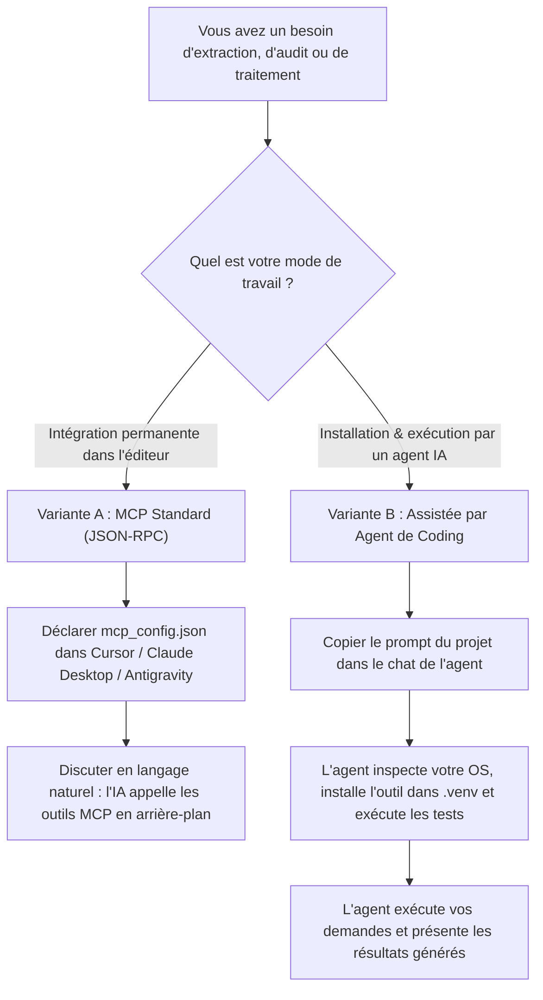

# 🧭 Guide Utilisateur Unifié — Suite MCP-Hybrid-Architecture

Bienvenue dans le guide utilisateur unifié de la suite **`mcp-hybrid-architecture`**. Ce document est conçu pour vous permettre de prendre en main, tester et exploiter chacun des 5 outils autonomes, que vous souhaitiez une intégration permanente dans votre éditeur ou une exécution au fil de l'eau assistée par une intelligence artificielle.

---

## 💡 Deux Parcours d'Utilisation au Choix

Selon votre flux de travail et vos préférences, deux parcours indépendants sont à votre disposition :



* **[Variante A — Intégration MCP Standard Permanente](./guide_mcp_standard.md) :**  
  Idéale si vous utilisez **Cursor**, **Claude Desktop**, **Antigravity IDE**, ou **Windsurf**. Vous déclarez les serveurs dans votre fichier de configuration (`mcp_config.json`). Les outils sont découverts automatiquement et votre assistant les invoque de manière transparente à chaque requête.
* **[Variante B — Installation et Exécution Assistées par Agent de Coding](./guide_installation_agent_coding.md) :**  
  Idéale si vous souhaitez déléguer l'installation et l'exécution à un agent autonome (Cursor Composer, Devin, Claude Code, Terminal d'IDE). Vous copiez un **prompt prêt à l'emploi** : l'agent inspecte votre machine, crée l'environnement virtuel, installe l'outil ciblé, valide les tests et vous remet un rapport clair avec les scénarios prêts à l'emploi.

---

## 🧭 Matrice d'Orientation des 5 Outils Métiers

Chaque outil est une **"Voiture Autonome"** conçue selon les principes de la Clean Architecture. Il fonctionne de manière 100 % autonome, dispose de sa propre logique métier, de ses tests et de ses interfaces d'accès (CLI, serveur MCP stdio et tableau de bord Web local).

| Outil | Répertoire | Rôle Métier Principal | Quand l'utiliser ? | Entrée Principale | Sorties Produites | Prérequis |
| :--- | :--- | :--- | :--- | :--- | :--- | :--- |
| **#01** | [`01_web_assets_manager/`](../01_web_assets_manager/) | **Gestionnaire d'Assets Web & Relieur React** | Vous avez des maquettes HTML avec des images distantes et vous voulez les rapatrier localement et mettre à jour vos composants React. | Fichiers HTML (`code.html`) | `assets-manifest.json`, images locales, composants React mis à jour | Node.js 18+ |
| **#02** | [`02_pdf_technical_extractor/`](../02_pdf_technical_extractor/) | **Extracteur Technique de Catalogues PDF** | Vous devez extraire des schémas CAO, découper des fiches techniques fabricant et convertir des pages PDF en images HD. | Fichier `.pdf` (catalogue, devis) | Rendu HD 150 DPI (PNG), images vectorielles, `manifest.json`, texte Markdown | Python 3.10+, PyMuPDF |
| **#03** | [`03_media_quality_auditor/`](../03_media_quality_auditor/) | **Contrôleur Qualité Photos & Dédoublonneur** | Vous disposez d'un dossier de visuels et vous devez éliminer les doublons MD5 et certifier la haute définition (>= 1200x700). | Dossier d'images locales | Rapport d'audit de netteté, sélection des photos Hero certifiées, doublons purgés | Python 3.10+, Pillow |
| **#04** | [`04_ecommerce_catalog_scanner/`](../04_ecommerce_catalog_scanner/) | **Scanneur de Catalogue E-commerce (Digest-First)** | Vous voulez aspirer et structurer les fiches produits, prix TTC/HT et références d'une boutique web sans saturer le contexte IA. | URL de boutique ou HTML local | `catalogue.json`, rapport HTML interactif sur disque, digest ultra-compact pour l'IA | Python 3.10+, BeautifulSoup4 |
| **#05** | [`05_visual_catalog_sync/`](../05_visual_catalog_sync/) | **Synchroniseur Visuel & Compilateur TypeScript** | Vous devez télécharger les photos d'un catalogue en respectant la limite Windows `MAX_PATH < 260` et générer un catalogue typé en TypeScript. | Fichier `catalogue.json` | Images téléchargées et renommées de façon sûre, `RawGlassRailingCatalog.ts`, inventaire Markdown | Python 3.10+ (0 dépendance externe) |

---

## 🗺️ Schéma du Cycle de Données entre les 5 Outils

Les 5 outils peuvent être utilisés séparément ou en chaîne industrielle continue sur un catalogue complexe :

```text
┌────────────────────────────────────────────────────────────────────────────────────────┐
│ CAS INDUSTRIEL D'EXEMPLE : CHAÎNE DE DONNÉES COMPLÈTE                                  │
│                                                                                        │
│   [Site Web Marchand / Démonstrateur BatiHome]                                         │
│                          │                                                             │
│                          ▼                                                             │
│   1. Outil #04 (Scanneur E-commerce) ──► Extraction DOM, prix TTC/HT, fiches produits  │
│                          │               Sortie : catalogue.json + rapport HTML        │
│                          ▼                                                             │
│   2. Outil #03 (Contrôleur Qualité)  ──► Audit des visuels, purge des doublons MD5     │
│                          │               Sortie : audit_report.json + photos certifiées│
│                          ▼                                                             │
│   3. Outil #05 (Synchroniseur)       ──► Safe-path Windows (<260 car.), compilation TS │
│                          │               Sortie : RawGlassRailingCatalog.ts            │
│                          ▼                                                             │
│   4. Outil #01 (Web Assets Manager)  ──► Intégration et reliaison des images React     │
│                          │               Sortie : components/*.tsx avec assets locaux  │
│                          ▼                                                             │
│   5. Outil #02 (Extracteur PDF)      ──► Découpe des fiches techniques associées       │
│                                          Sortie : fiches d'assemblage CAO HD (PNG)     │
└────────────────────────────────────────────────────────────────────────────────────────┘
```

---

## 📚 Sommaire des Guides de la Suite

Pour continuer votre prise en main selon vos besoins, consultez les guides spécialisés :

1. 🤖 [**Guide d'Installation & Prompts pour Agent de Coding (Variante B)**](./guide_installation_agent_coding.md)  
   *Prompts prêts à copier-coller pour installer et utiliser n'importe quel outil via votre assistant IA.*
2. 🔌 [**Guide d'Intégration MCP Standard (Variante A)**](./guide_mcp_standard.md)  
   *Déclaration JSON-RPC dans Cursor, Claude Desktop et Antigravity IDE, premier appel et demandes en langage naturel.*
3. 🎯 [**Bibliothèque de Scénarios Pratiques**](./scenarios_utilisation.md)  
   *Exemples concrets pas-à-pas avec prompts, outils mobilisés, résultats attendus et critères de validation.*
4. 🩺 [**Diagnostic, Dépannage & Procédures de Validation**](./diagnostic_et_depannage.md)  
   *Contrôle de santé (`doctor.bat`), résolution des erreurs fréquentes, tests de non-régression et désinstallation propre.*
